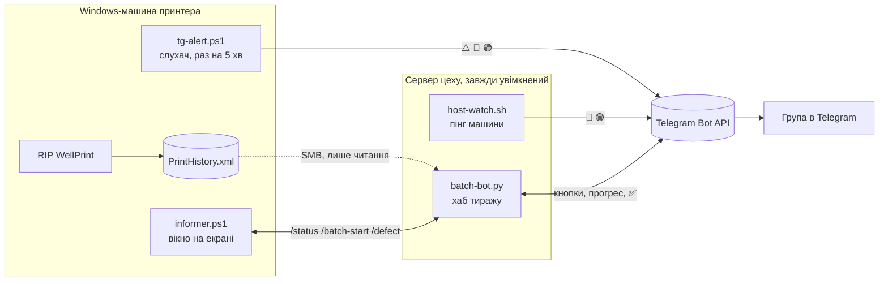

# WellPrint UV-принтер: Windows-машина, Telegram-алерти, бот тиражу, інформер
> Скрипти з гайда лежать у папках `machine/` (ставиться на Windows-машину принтера) і `server/` (сервер цеху). Текст нижче — повна інструкція


## Що реалізовано

За годину роботи ваші принтерні (або будь-які інші Windows) машини самі пишуть вам у Telegram, коли щось пішло не так. Без хмарних підписок і сторонніх сервісів, крім самого Telegram: бот, один легкий скрипт на машині та один завжди увімкнений компʼютер цеху (Mac, Linux, NAS або друга Windows), на якому живе все важке. Без нього працюють лише алерти з самої машини (⚠️ 🔴 🟢); для 🔌 «машина не відповідає», бота тиражу й інформера він потрібен. Гайд написано за робочою схемою друкарні Drukva.

Три функції, кожна незалежна: можна зробити лише першу або всі три.

| Функція | Що отримуєте | Де в гайді |
| --- | --- | --- |
| 1. Алерти в Telegram | ⚠️ машина перезавантажилась, 🔴 програма принтера не запущена, 🟢 відновлено, 🔌 машина не відповідає | Частина 2, кроки 3–5 |
| 2. Бот тиражу | «Старт друку» → машина → по скільки → скільки всього → прогрес по столах → «✅ Тираж готовий», кнопка «⏹ Зупинити» | Частина 3, кроки 6–9 |
| 3. Інформер на екрані машини | вікно поверх RIP: прогрес тиражу, відлік до кінця столу, кнопки «Старт» і «Брак» | Частина 4, крок 10 |

Приклади повідомлень функції 1 (перевірено у друкарні Drukva на двох машинах з UV-принтером):

- ⚠️ **Windows перезавантажився** о 10:34 (аптайм 1 хв). WellPrint НЕ запущений. Перевір принтер і панель.
- 🔴 **WellPrint не запущений** уже 16 хв. Принтер без спітів, сопла сохнуть. Запусти WellPrint.
- 🟢 **WellPrint знову працює** (лежав із 10:35).
- 🔌 **Машина не відповідає** 10 хв (цей алерт шле інший компʼютер, бо мертва машина про себе не повідомить).

## Базове налаштування, спільне для всіх функцій

Схема з трьох складових:

1. **Бот Telegram** і група, куди він пише. Робиться один раз за 10 хвилин у застосунку Telegram.
2. **Слухач на машині**: скрипт PowerShell, який раз на 5 хвилин читає два факти (чи живий потрібний процес, скільки хвилин аптайм) і за правилами шле повідомлення. Він лише читає, нічого не запускає і не вбиває.
3. **Сервер цеху**: один завжди увімкнений компʼютер (Mac, Linux, NAS або друга Windows), який пінгує машину й повідомляє, коли вона зникла, а для функцій 2–3 ще й веде лічильник тиражу.

Порядок роботи. Спершу базове налаштування (частина 1): крок 0 — Windows-машина, кроки 1–2 — бот, група й тест; сервер цеху готується в кроці 6. Потім функції в будь-якому порядку: функція 1 — частина 2 (кроки 3–5), функція 2 — частина 3 (кроки 6–9), функція 3 — частина 4 (крок 10).



Машина звітує про себе легким слухачем. Усе решта робить сервер цеху: пінгує машину, читає її історію друку з мережевої папки, слухає кнопки в групі й рахує тираж.

## Частина 1. Базове налаштування: Windows-машина, бот, група

Кроки 0–2. Без них не працює жодна функція.

## Крок 0. Підготовка Windows-машини принтера

Без цього сповіщення будуть, а спокою ні: машина має сама підніматись після збою живлення, сама заходити в систему, сама стартувати програму принтера і **ніколи не перезавантажуватись сама заради оновлень**. Усе нижче — з PowerShell від адміністратора, крім пунктів, де сказано «мишкою».

**1. Живлення: ніколи не спати, стартувати після збою.**

```
powercfg /change standby-timeout-ac 0
powercfg /change hibernate-timeout-ac 0
powercfg /change monitor-timeout-ac 0
powercfg /h off
```

Автостарт після збою живлення задається не в Windows: на звичайному ПК це BIOS/UEFI → Power → «After Power Loss: Power On»; на Mac mini з Boot Camp — мишкою в треї **Boot Camp Control Panel → Power → галочка «Restart automatically after a power failure»** (команди з macOS не діють, Windows перезаписує їх при старті). Перевірка лише тестом: витягнути шнур на 10 секунд при вимкненому принтері.

**2. Автологін.** Без нього після ребуту машина стоїть на екрані пароля, і програма принтера не стартує. Найнадійніше — утиліта Microsoft [Autologon](https://learn.microsoft.com/sysinternals/downloads/autologon): запустити, ввести користувача й пароль, Enable. Пароль зберігається зашифрованим. Машина при цьому має стояти в цеху, а не в публічному місці.

**3. Автостарт програми принтера.** Тільки стандартний ярлик у папці автозавантаження користувача: Win+R → `shell:startup` → скопіювати туди ярлик WellPrint. Не створюйте для нього задач планувальника з підвищеними правами, затримками чи «перезапустити, якщо впала»: у друкарні Drukva такий старт без людини після нічного ребуту закінчився виливом чорнила. Ярлик + автологін достатньо, а алерт ⚠️ про ребут кличе людину подивитись на помпи.

**4. Windows Update: оновлення ставяться, але ребут лише руками.** Два ключі політики (працюють у Pro, у Home — теж, бо це реєстр):

```
$k = 'HKLM:\SOFTWARE\Policies\Microsoft\Windows\WindowsUpdate\AU'
New-Item -Path $k -Force | Out-Null
Set-ItemProperty $k NoAutoRebootWithLoggedOnUsers 1 -Type DWord   # не ребутити, поки хтось увійшов (автологін = завжди)
Set-ItemProperty $k AUOptions 3 -Type DWord                        # 3 = завантажувати, питати перед встановленням; 4 = ставити за розкладом
```

Додатково мишкою: Параметри → Оновлення → Період активності → задати години роботи цеху (максимум 18 годин). Оновлення ставите раз на місяць руками при вимкненому принтері й одразу перезавантажуєте. Якщо машина не дивиться в інтернет нічим, крім слухача, можна жорсткіше: `NoAutoUpdate 1` у тому ж ключі (повністю ручні оновлення, так у друкарні Drukva).

**5. Мережа.** Статична IP або резерв у DHCP роутера; зрозуміле імʼя компʼютера (`Rename-Computer -NewName UF-3570 -Restart`); дозволити ping: `Set-NetFirewallRule -DisplayGroup 'File and Printer Sharing' -Enabled True -Profile Private`; часовий пояс `Set-TimeZone 'FLE Standard Time'` (Київ), інакше час у сповіщеннях бреше.

**6. Дистанційний доступ.** RDP (`Set-ItemProperty 'HKLM:\System\CurrentControlSet\Control\Terminal Server' fDenyTSConnections 0` + `Enable-NetFirewallRule -DisplayGroup 'Remote Desktop'`) або RustDesk/AnyDesk, щоб після алерту зайти й подивитись, не їдучи в цех. Увага: сеанс RDP замикає локальний екран, після відключення машина лишається на екрані блокування, і це нормально для програми принтера, яка вже запущена.

**7. На машині більше нічого.** Жодних антивірусів зі скануванням за розкладом, хмарних синків, браузера в автозапуску, рипу чи бекапів під час друку. Усе важке живе на сервері цеху (частина 3). На машині залишається один слухач алертів (крок 3), який раз на 5 хвилин на півсекунди читає два факти, та мережева папка на читання для сервера (крок 6).

## Крок 1. Бот і група в Telegram

Потрібні дві речі: **токен бота** (пароль, яким скрипт підписує запити) і **chat\_id** (куди слати). Усе робиться в застосунку Telegram, 10 хвилин.

1. Відкрийте чат із **@BotFather**, надішліть `/newbot`. Він спитає імʼя (будь-яке, наприклад `Цех алерти`) і юзернейм (має закінчуватись на `bot`, наприклад `my_shop_alerts_bot`).
2. У відповідь прийде токен виду `123456789:AAH4k...` (приблизно 46 символів). Збережіть його: це секрет, хто має токен, той пише від імені бота. Якщо витік, у BotFather `/revoke` видає новий.
3. Створіть **групу**, наприклад `Цех: алерти`, тип приватна. У групі всі учасники бачать алерти й можуть писати боту, наприклад слово `друк` (функція 2).
4. Додайте бота в групу й зробіть його **адміністратором**. Слати алерти він може і як звичайний учасник, але повідомлення людей у групі (слово `друк`) бачить лише як адміністратор.
5. Додайте в групу людей, які мають бачити алерти. Кількість практично не обмежена, кожен отримує сповіщення на свій телефон; нових можна додавати будь-коли без змін у скриптах.
6. Дізнайтесь **chat\_id** групи (до запуску хаба з частини 3). Напишіть у групі будь-що, відкрийте в браузері `https://api.telegram.org/bot<ТОКЕН>/getUpdates` і знайдіть `"chat":{"id":-1001234567890,...,"type":"supergroup"}`. Id групи завжди відʼємний: у звичайної групи на кшталт `-4123456789`, у супергрупи починається з `-100`. Якщо Telegram перетворить групу на супергрупу, id зміниться: візьміть новий так само й оновіть `config.json`.

| Що | Приклад | Де взяти |
| --- | --- | --- |
| Токен бота | `123456789:AAH4kZ...` | BotFather після `/newbot` |
| chat\_id групи | `-1001234567890` | getUpdates після повідомлення в групі |
| Юзернейм бота | `@my_shop_alerts_bot` | ви самі задали в BotFather |

Якщо замість групи хочете, щоб бот писав вам особисто: напишіть боту `/start`, потім відкрийте в браузері `https://api.telegram.org/bot<ТОКЕН>/getUpdates`, у відповіді буде `"chat":{"id":12345678,...}`, це ваш особистий chat\_id (додатний). Ми радимо групу: до неї можна підʼєднати скільки завгодно людей і телефонів без перенастроювання скриптів.

## Крок 2. Перевірте відправку з командного рядка

Перш ніж ставити скрипти, переконайтесь, що токен і chat\_id правильні. Одна команда з будь-якого компʼютера з інтернетом. На Windows 10/11 `curl.exe` вже є (саме `curl.exe`, бо голе `curl` у PowerShell це інша команда).

```
curl.exe -s -X POST "https://api.telegram.org/bot<ТОКЕН>/sendMessage" -d "chat_id=-1001234567890" -d "text=Тест алертів"
```

Успіх: у групі зʼявилось повідомлення, а у відповіді є `"ok":true`. Друга корисна команда, щоб перевірити сам токен: `curl.exe -s https://api.telegram.org/bot<ТОКЕН>/getMe` має повернути юзернейм вашого бота.

| Відповідь Telegram | Причина | Що робити |
| --- | --- | --- |
| `401 Unauthorized` | токен неправильний або відкликаний | скопіювати заново з BotFather, без пробілів |
| `400 chat not found` | бот не в групі, або id з помилкою (без мінуса чи старий, до перетворення на супергрупу) | додати бота адміністратором, перевірити id |
| `403 bot is not a member` | бота видалили з групи | додати знову |
| `403 bot was blocked by the user` | особистий чат, людина не натиснула `/start` | написати боту `/start` |
| тиша, таймаут | немає інтернету або `api.telegram.org` заблоковано на роутері | перевірити файрвол, дозволити вихідний HTTPS |

Кирилиця в `curl.exe` з консолі Windows може прийти кракозябрами. Це не страшно для тесту, а скрипт у кроці 3 шле текст як UTF-8 і цієї проблеми не має.

## Частина 2. Функція 1: алерти в Telegram

Кроки 3–5: слухач на машині, задача планувальника, зовнішній сторож на сервері цеху.

## Крок 3. Слухач на Windows-машині

Один файл PowerShell, який раз на 5 хвилин читає два факти і за правилами шле повідомлення. Він тримає стан між запусками у `state.json`, тому не спамить: ребут повідомляється один раз, «лежить» повторюється раз на годину, «відновлено» приходить один раз.

Логіка (саме так працює у друкарні Drukva):

| Умова | Повідомлення | Повтор |
| --- | --- | --- |
| аптайм Windows ≤ 30 хв | ⚠️ Windows перезавантажився о HH:MM, чи запущена програма | один раз на кожне завантаження |
| процес не знайдено ≥ 15 хв | 🔴 Програма не запущена вже N хв | раз на 60 хв, поки лежить |
| процес знову є після 🔴 | 🟢 Знову працює (лежав із HH:MM) | один раз |

Створіть папку `C:\ProgramData\tg-alert\` і покладіть туди два файли.

**Файл `config.json`** (токен і чат окремо від скрипта, щоб скрипт можна було показувати й копіювати):

```
{ "token": "123456789:AAH4kZ...", "chat_id": "-1001234567890", "process": "WellPrintMacExp", "label": "UF-3570" }
```

`process` — імʼя процесу без `.exe`, як його показує диспетчер задач (у колонці «Подробиці»). `label` — як підписувати машину в повідомленнях.

**Файл `tg-alert.ps1`.** Зберігайте як **UTF-8 з BOM** (у Блокноті: «Зберегти як» → кодування «UTF-8 with BOM»), інакше PowerShell 5.1 зіпсує кирилицю й емодзі.

```
# tg-alert.ps1 — слухач стану машини. Лише читає (процес, аптайм) і шле в Telegram.
# Нічого не запускає, не вбиває, не змінює. Стан: state.json, лог: alert.log.
param([switch]$Test)
$ErrorActionPreference = 'SilentlyContinue'
$Dir = 'C:\ProgramData\tg-alert'
$DownAfterMin  = 15     # процес лежить довше → алерт
$RepeatMin     = 60     # повтор алерту, поки лежить
$BootWindowMin = 30     # аптайм менший → «щойно перезавантажився»

$cfg   = Get-Content (Join-Path $Dir 'config.json') -Raw -Encoding UTF8 | ConvertFrom-Json
$Token = $cfg.token; $Chat = $cfg.chat_id; $Proc = $cfg.process; $Label = $cfg.label
$StateFile = Join-Path $Dir 'state.json'
$Log = Join-Path $Dir 'alert.log'

function Log($m) { Add-Content -Path $Log -Value ((Get-Date).ToString('yyyy-MM-dd HH:mm:ss') + ' ' + $m) -Encoding UTF8 }
function Send($text) {
    $json  = @{ chat_id = $Chat; text = ('🖨 ' + $Label + ': ' + $text); disable_web_page_preview = $true } | ConvertTo-Json -Compress
    $bytes = [Text.Encoding]::UTF8.GetBytes($json)
    try {
        $r = Invoke-RestMethod -Method Post -Uri ('https://api.telegram.org/bot' + $Token + '/sendMessage') -ContentType 'application/json; charset=utf-8' -Body $bytes -TimeoutSec 20
        Log ('SEND ok: ' + $text)
    } catch { Log ('SEND FAIL: ' + $text + ' => ' + $_.Exception.Message) }
}

if ($Test) { Send ('Тест слухача ' + (Get-Date).ToString('HH:mm')); exit 0 }

$st = @{ down_since = $null; down_alerted_at = $null; boot_alerted = '' }
if (Test-Path $StateFile) {
    try { $j = Get-Content $StateFile -Raw | ConvertFrom-Json; foreach ($k in 'down_since','down_alerted_at','boot_alerted') { $st[$k] = $j.$k } } catch {}
}

$now   = Get-Date
$boot  = (Get-CimInstance Win32_OperatingSystem).LastBootUpTime
$upMin = [int](($now - $boot).TotalMinutes)
$running = [bool](Get-Process $Proc -ErrorAction SilentlyContinue)

# 1) ребут Windows — один алерт на кожне завантаження
$bootKey = $boot.ToString('yyyyMMddHHmmss')
if ($upMin -le $BootWindowMin -and $st.boot_alerted -ne $bootKey) {
    $s = if ($running) { $Proc + ' запущений (автозапуск)' } else { $Proc + ' НЕ запущений' }
    Send ('⚠️ Windows перезавантажився о ' + $boot.ToString('HH:mm') + ' (аптайм ' + $upMin + ' хв). ' + $s + '. Перевір машину.')
    $st.boot_alerted = $bootKey
}

# 2) процес лежить
if (-not $running) {
    if (-not $st.down_since) { $st.down_since = $now.ToString('o') }
    $downMin = [int](($now - [datetime]$st.down_since).TotalMinutes)
    $last = if ($st.down_alerted_at) { [datetime]$st.down_alerted_at } else { $null }
    if ($downMin -ge $DownAfterMin -and (-not $last -or ($now - $last).TotalMinutes -ge $RepeatMin)) {
        Send ('🔴 ' + $Proc + ' не запущений уже ' + $downMin + ' хв. Запусти програму.')
        $st.down_alerted_at = $now.ToString('o')
    }
} else {
    if ($st.down_alerted_at) { Send ('🟢 ' + $Proc + ' знову працює (лежав із ' + ([datetime]$st.down_since).ToString('HH:mm') + ').') }
    $st.down_since = $null; $st.down_alerted_at = $null
}

[IO.File]::WriteAllText($StateFile, ($st | ConvertTo-Json -Compress), (New-Object System.Text.UTF8Encoding($false)))
```

Перевірка руками, з PowerShell від адміністратора:

```
powershell -NoProfile -ExecutionPolicy Bypass -File C:\ProgramData\tg-alert\tg-alert.ps1 -Test
Get-Content C:\ProgramData\tg-alert\alert.log -Tail 3
```

У групі має зʼявитись «🖨 UF-3570: Тест слухача 12:41», а в логу рядок `SEND ok`. Якщо `SEND FAIL`, текст помилки в тому ж рядку, звірте з таблицею кроку 2.

Щоб стежити за іншою програмою (RIP, драйвер, сервер черги), змініть лише `process` у `config.json`. Для двох програм на одній машині простіше зробити другу копію папки з іншим `config.json` і другу задачу.

## Крок 4. Задача планувальника

Скрипт має працювати завжди: до входу користувача, на заблокованому екрані, без вікон. Тому задача йде від **SYSTEM**, запускається **при старті системи і кожні 5 хвилин**, а через маленький `.vbs` вікно PowerShell не блимає на екрані.

**Файл `tg-alert.vbs`** (три рядки, у ту ж папку):

```
Set sh = CreateObject("WScript.Shell")
sh.Run "powershell.exe -NoProfile -WindowStyle Hidden -ExecutionPolicy Bypass -File C:\ProgramData\tg-alert\tg-alert.ps1", 0, False
```

**Реєстрація задачі.** Відкрийте PowerShell від адміністратора і виконайте блок цілком:

```
$d = 'C:\ProgramData\tg-alert'
$a  = New-ScheduledTaskAction -Execute 'wscript.exe' -Argument ('//nologo ' + (Join-Path $d 'tg-alert.vbs'))
$t1 = New-ScheduledTaskTrigger -AtStartup
$t2 = New-ScheduledTaskTrigger -Once -At (Get-Date).Date -RepetitionInterval (New-TimeSpan -Minutes 5)
$p  = New-ScheduledTaskPrincipal -UserId 'SYSTEM' -LogonType ServiceAccount -RunLevel Highest
$s  = New-ScheduledTaskSettingsSet -AllowStartIfOnBatteries -DontStopIfGoingOnBatteries -ExecutionTimeLimit (New-TimeSpan -Minutes 3) -MultipleInstances IgnoreNew
Register-ScheduledTask -TaskName 'TG-Alert' -Action $a -Trigger @($t1,$t2) -Principal $p -Settings $s -Force | Out-Null
(Get-ScheduledTask 'TG-Alert').State
icacls $d /inheritance:r /grant:r 'SYSTEM:(OI)(CI)F' 'Administrators:(OI)(CI)F' | Out-Null
```

Останній рядок закриває папку з токеном від звичайних користувачів. Відповідь `Ready` означає, що задача стоїть. Через 5 хвилин у `alert.log` зʼявиться перший запис (або нічого, якщо все гаразд і слати нема чого, тоді дивіться на час зміни `state.json`).

Повний тест ланцюжка — закрийте програму, за якою стежите, і зачекайте 15 хвилин: має прийти 🔴. Запустіть знову, за 5 хвилин прийде 🟢. Перезавантажте машину (коли принтер вимкнений): за 1–5 хвилин після старту прийде ⚠️.

Корисні команди потім:

| Що | Команда |
| --- | --- |
| стан задачі й останній запуск | `Get-ScheduledTaskInfo 'TG-Alert'` |
| запустити зараз | `Start-ScheduledTask 'TG-Alert'` |
| тимчасово вимкнути (сервіс принтера) | `Disable-ScheduledTask 'TG-Alert'` |
| увімкнути знову | `Enable-ScheduledTask 'TG-Alert'` |
| прибрати зовсім | `Unregister-ScheduledTask 'TG-Alert' -Confirm:$false` |

Не забувайте вмикати задачу назад після сервісу. У друкарні Drukva одна машина простояла з вимкненим слухачем кілька днів, і її ребути ніхто не бачив.

## Крок 5. Зовнішній сторож: «машина не відповідає»

Слухач з кроку 3 мовчить, коли машина вимкнена, зависла або відпала від мережі. Це має помітити інший компʼютер, який завжди увімкнений: сервер, NAS, Mac mini, Raspberry Pi, або друга Windows-машина цеху. Нижче варіант для macOS/Linux (bash + cron); логіка та сама, що й у слухача: стан у файлі, алерт один раз, повтор раз на годину, «відновлено» один раз.

На машині, за якою стежите, задайте **статичну IP** (або резерв у DHCP роутера) і дозвольте відповідати на ping: Брандмауер Windows → правило «Спільний доступ до файлів і принтерів (ехо-запит ICMPv4)» увімкнути для приватної мережі.

**Файл `host-watch.sh`** на сторожовому компʼютері (наприклад `~/host-watch/host-watch.sh`, поруч `config` з токеном):

```
#!/bin/bash
# host-watch.sh — пінгує машину й шле в Telegram, коли вона зникла / повернулась.
# config поруч із скриптом (chmod 600): TOKEN=..., CHAT=..., HOST=192.168.1.20, LABEL=UF-3570
DIR="$(cd "$(dirname "$0")" && pwd)"; . "$DIR/config"
DOWN_AFTER=10; REPEAT=60          # хвилин
STATE="$DIR/state.$HOST"; LOG="$DIR/watch.log"
now=$(date +%s)
send() { curl -s -m 20 -X POST "https://api.telegram.org/bot$TOKEN/sendMessage" --data-urlencode "chat_id=$CHAT" --data-urlencode "text=🖨 $LABEL: $1" >/dev/null; echo "$(date '+%F %T') SEND: $1" >>"$LOG"; }

# три пінги, досить одного успішного
if ping -c 3 -W 2 "$HOST" >/dev/null 2>&1; then up=1; else up=0; fi

# стан: down_since alerted_at
read -r down_since alerted_at < "$STATE" 2>/dev/null || { down_since=0; alerted_at=0; }

if [ "$up" = 0 ]; then
  [ "$down_since" = 0 ] && down_since=$now
  mins=$(( (now - down_since) / 60 ))
  if [ "$mins" -ge "$DOWN_AFTER" ] && [ $(( (now - alerted_at) / 60 )) -ge "$REPEAT" ]; then
    send "🔌 Машина $HOST не відповідає вже $mins хв (вимкнена, зависла або без мережі)."
    alerted_at=$now
  fi
else
  [ "$alerted_at" != 0 ] && send "🟢 Машина $HOST знову в мережі (не відповідала з $(date -r "$down_since" '+%H:%M' 2>/dev/null || date -d "@$down_since" '+%H:%M'))."
  down_since=0; alerted_at=0
fi
echo "$down_since $alerted_at" > "$STATE"
```

Запуск раз на 5 хвилин через cron (`crontab -e`):

```
*/5 * * * * /bin/bash /Users/<ви>/host-watch/host-watch.sh
```

Перевірка: `bash host-watch.sh` руками, потім витягніть мережевий кабель із машини на 15 хвилин: має прийти 🔌, після повернення кабеля за 5 хвилин 🟢. Одна копія скрипта на кожну машину зі своїм `config`, або один рядок cron на кожну з іншим файлом конфігу.

Якщо сторожовий компʼютер теж Windows, той самий принцип пишеться на PowerShell: `Test-Connection -ComputerName $Host -Count 3 -Quiet` замість ping, решта як у кроці 3 і 4. Якщо у вас роутер MikroTik, те саме вміє його вбудований Netwatch (`/tool netwatch`, скрипти up/down з `/tool fetch` на ту саму адресу Bot API), без окремого компʼютера.

## Частина 3. Функція 2: бот керування тиражем

Той самий бот у тій самій групі може не лише попереджати, а й рахувати тираж. Оператор запускає тираж у вікні інформера на машині (Крок 10): вводить, по скільки штук кладе на стіл і скільки треба всього. Запасний варіант — кнопка «Старт друку» в групі. Далі бот сам рахує кожен завершений джоб, пише прогрес «24/100 шт (раунд 3/13)» і в кінці «✅ Тираж готовий». Кнопка «Зупинити» скидає лічильник.

Топологія — **один сервер на все.** Той самий завжди увімкнений компʼютер, що в кроці 5 пінгує машини, тепер ще й веде чергу: на ньому крутиться хаб `batch-bot.py`, який слухає кнопки в Telegram і читає історію друку машини через мережеву папку. На принтерній машині нічого нового не ставиться, лише відкривається папка на читання. Запасний варіант, коли мережеву папку зробити не можна: маленький вотчер на машині шле події в хаб (крок 8).

Джерело істини «джоб надруковано» для WellPrint — файл `PrintHistory.xml`: програма дописує в нього один запис на кожне завершене завдання. Запис рахується, коли `jobCancel` = false і `copyCount_complete` = `copyCount_all`. Лежить він у папці WellPrint: `AssemblyData\Variable\<голова>\<конфіг>\PrintHistory.xml` (імена папок «голова» і «конфіг» у кожного принтера свої), кодування GB2312. Для іншого софту принтера шукайте свій аналог: будь-який лог або історія, де зʼявляється рядок на кожен готовий джоб, і правиться лише функція `read_records` у хабі.

## Крок 6. Сервер цеху й мережева папка

Сервер — будь-який компʼютер, який не вимикають: Mac mini, Linux-коробка, NAS із Python, Raspberry Pi або друга Windows-машина (наприклад та, де стоїть RIP). Потрібні Python 3.8 або новіший (`python3 --version`), доступ до машини по локальній мережі й інтернет. Сторонні бібліотеки не потрібні.

Той самий бот і та сама група, що й для алертів. Два обмеження Telegram, які варто знати наперед:

- Слово `друк` у групі бот бачить, лише коли він там **адміністратор** (ви це вже зробили в кроці 1) або коли в BotFather вимкнено режим приватності: `/setprivacy` → Disable. Натискання кнопок він бачить завжди.
- Опитувати бота (`getUpdates`) може **лише один процес**. Другий запущений хаб дістане `409 Conflict`. Скрипти алертів з частини 2 лише шлють і не заважають.

**Мережева папка на машині принтера** (Windows). Відкрийте папку WellPrint на читання для окремого користувача:

1. Створіть локального користувача без прав адміністратора, наприклад `hubreader` з паролем (PowerShell від адміністратора: `net user hubreader <пароль> /add`).
2. Права клікніть на папці WellPrint → Властивості → Доступ → Розширені налаштування → «Надати спільний доступ», імʼя шари `WellPrint`, Дозволи: лише `hubreader`, лише «Читання».
3. Перевірте з іншого компʼютера: `\\UF-3570\WellPrint` відкривається, файл `PrintHistory.xml` читається, записати туди нічого не можна.

**Підключення папки на сервері** (має підніматись само після ребуту):

| Сервер | Як підключити | Шлях до файла для config.json |
| --- | --- | --- |
| Windows | нічого, UNC-шлях працює напряму; пароль зберегти через `cmdkey /add:UF-3570 /user:hubreader /pass:<пароль>` | `\\\\UF-3570\\WellPrint\\AssemblyData\\Variable\\<голова>\\<конфіг>\\PrintHistory.xml` (у JSON кожен `\` подвоєний) |
| macOS | `sudo mkdir -p /Volumes/uf3570` і рядок у `/etc/auto_master`/`autofs`, або простіше: монтувати в самому стартовому скрипті хаба: `mount_smbfs //hubreader:<пароль>@UF-3570/WellPrint /Volumes/uf3570` | `/Volumes/uf3570/AssemblyData/Variable/<голова>/<конфіг>/PrintHistory.xml` |
| Linux | `apt install cifs-utils`; файл `/root/.smb-uf` з `username=hubreader` / `password=...` (chmod 600); рядок у `/etc/fstab`: `//UF-3570/WellPrint /mnt/uf3570 cifs credentials=/root/.smb-uf,ro,iocharset=utf8,_netdev,x-systemd.automount 0 0` | `/mnt/uf3570/AssemblyData/Variable/<голова>/<конфіг>/PrintHistory.xml` |

Перевірка на сервері: `ls -la <шлях>` показує файл і його час зміни збігається з останнім друком. Якщо шару зробити не вдається (політики, домен, інша підмережа), лишіть шлях порожнім і переходьте до кроку 8.

## Крок 7. Хаб batch-bot.py на сервері

Один файл Python без залежностей. Він робить три речі одночасно: слухає кнопки бота (довге опитування, публічна адреса й HTTPS не потрібні), раз на 5 секунд дивиться, чи змінився `PrintHistory.xml` на шарі, і тримає маленький HTTP-порт для запасного вотчера. Навантаження на машину принтера — одне читання файла на кілька сот кілобайт після кожного джоба, між джобами лише запит часу зміни.

Папка на сервері, наприклад `~/batch-bot/`, в ній два файли.

**Файл `config.json`:**

```
{
  "token": "123456789:AAH4kZ...",
  "chat_id": "-1001234567890",
  "hub_token": "будь-який-довгий-пароль-для-вотчера",
  "port": 8765,
  "machines": {
    "UF-3570": "/mnt/uf3570/AssemblyData/Variable/<голова>/<конфіг>/PrintHistory.xml",
    "UF-6045": ""
  }
}
```

`machines` — список кнопок «обери машину». Значення — шлях до її `PrintHistory.xml` на шарі, або порожній рядок, якщо для цієї машини події приходять від вотчера (крок 8). Одна машина — один запис. `hub_token` придумайте самі, це пароль між вотчером і хабом.

**Файл `batch-bot.py`:**

```python
#!/usr/bin/env python3
"""batch-bot.py — хаб керування тиражем з Telegram. Python 3.8+, без сторонніх бібліотек.
(1) слухає бота (getUpdates, довге опитування), веде діалог «Старт друку → машина → по скільки → скільки всього»;
(2) сам читає PrintHistory.xml машин через мережеву шару (history у config) і рахує столи;
    запасний варіант — POST /print-done від вотчера print-watch.ps1 на машині;
(3) пише прогрес і «Тираж готовий» у канал. Стан — state.json поруч зі скриптом;
(4) віддає стан інформеру на машині: GET /status, POST /batch-start, POST /defect (заголовок X-Hub-Token).
Запуск: python3 batch-bot.py   (config.json поруч, див. гайд)
"""
import json, os, re, sys, time, threading, urllib.request, urllib.parse
from http.server import BaseHTTPRequestHandler, HTTPServer

DIR = os.path.dirname(os.path.abspath(__file__))
CFG = json.load(open(os.path.join(DIR, "config.json"), encoding="utf-8"))
TOKEN, CHAT = CFG["token"], str(CFG["chat_id"])
HUB_TOKEN, PORT = CFG["hub_token"], int(CFG.get("port", 8765))
MACHINES = list(CFG["machines"].keys())          # {"UF-3570": "<шлях до PrintHistory.xml або порожньо>"}
HISTORY = {m: p for m, p in CFG["machines"].items() if p}
STALE_SEC, HIST_POLL = 2 * 86400, 5
PERS, TOTALS = [1, 2, 4, 6, 8], [10, 20, 30, 50, 100, 200]
STATE_FILE, LOG_FILE = os.path.join(DIR, "state.json"), os.path.join(DIR, "bot.log")
API = "https://api.telegram.org/bot%s/" % TOKEN
lock = threading.Lock()


def log(m):
    line = time.strftime("%Y-%m-%d %H:%M:%S ") + m
    print(line, flush=True)
    with open(LOG_FILE, "a", encoding="utf-8") as f:
        f.write(line + "\n")


def load():
    try:
        return json.load(open(STATE_FILE, encoding="utf-8"))
    except Exception:
        return {"flow": None, "batch": None, "last": None, "offset": 0, "seen": {}}


def save(st):
    tmp = STATE_FILE + ".tmp"
    json.dump(st, open(tmp, "w", encoding="utf-8"), ensure_ascii=False)
    os.replace(tmp, STATE_FILE)


def tg(method, **params):
    data = json.dumps(params).encode("utf-8")
    req = urllib.request.Request(API + method, data=data, headers={"Content-Type": "application/json"})
    try:
        return json.load(urllib.request.urlopen(req, timeout=40))
    except Exception as e:
        log("tg %s fail: %s" % (method, e))
        return None


def kb(rows):
    return {"inline_keyboard": rows}


def send(text, rows=None):
    tg("sendMessage", chat_id=CHAT, text=text, parse_mode="HTML", reply_markup=kb(rows or []))


def edit(mid, text, rows=None):
    tg("editMessageText", chat_id=CHAT, message_id=mid, text=text, parse_mode="HTML", reply_markup=kb(rows or []))


def chunk(items, n):
    return [items[i:i + n] for i in range(0, len(items), n)]


# ───────── діалог ─────────
def send_start():
    send("🖨 <b>Друк</b> — керування тиражем.", [[{"text": "▶️ Старт друку", "callback_data": "start"}]])


def ask_total(mid):
    rows = chunk([{"text": str(t), "callback_data": "t:%d" % t} for t in TOTALS] + [{"text": "✏️", "callback_data": "t:ask"}], 3)
    txt = "🖨 Скільки <b>всього</b> штук у тиражі?"
    edit(mid, txt, rows) if mid else send(txt, rows)


def begin(st, machine, per, total, src=""):
    """Старт тиражу — спільний для кнопок бота і для «Старт» в інформері на машині."""
    per, total = max(1, int(per)), max(1, int(total))
    rounds = max(1, -(-total // per))             # ceil
    st["batch"] = {"machine": machine, "per": per, "total": total, "rounds": rounds, "done": 0,
                   "defects": 0, "start_ts": int(time.time()), "ticks": [], "at": time.strftime("%Y-%m-%d %H:%M")}
    st["flow"], st["last"] = None, None
    txt = ("▶️ <b>Друк запущено</b>%s\n🖨 %s\nВсього: <b>%d</b> шт · по %d за раз · %d стіл(ів)\n\nДрукуй — рахую. Напишу, коли готово."
           % ((" (%s)" % src) if src else "", machine, total, per, rounds))
    log("batch start %s" % st["batch"])
    return txt, [[{"text": "⏹ Зупинити", "callback_data": "stop"}]]


def start_batch(st, total, mid):
    flow = st["flow"] or {}
    txt, rows = begin(st, flow.get("machine", MACHINES[0]), flow.get("per", 1), total)
    edit(mid, txt, rows) if mid else send(txt, rows)


def on_callback(st, cq):
    data, mid = cq.get("data", ""), cq["message"]["message_id"]
    tg("answerCallbackQuery", callback_query_id=cq["id"])
    if data == "start":
        st["flow"] = {"step": "machine"}
        edit(mid, "🖨 <b>Друк</b> — обери машину:", [[{"text": m, "callback_data": "m:" + m} for m in MACHINES]])
    elif data.startswith("m:"):
        st["flow"] = {"step": "per", "machine": data[2:]}
        rows = chunk([{"text": str(p), "callback_data": "p:%d" % p} for p in PERS] + [{"text": "✏️", "callback_data": "p:ask"}], 3)
        edit(mid, "🖨 Скільки штук <b>за раз</b> (на стіл)?", rows)
    elif data.startswith("p:") and st["flow"]:
        if data == "p:ask":
            st["flow"]["step"] = "per_input"
            edit(mid, "✏️ Напиши <b>скільки за раз</b> (число):")
        else:
            st["flow"].update(step="total", per=int(data[2:]))
            ask_total(mid)
    elif data.startswith("t:") and st["flow"]:
        if data == "t:ask":
            st["flow"]["step"] = "total_input"
            edit(mid, "✏️ Напиши <b>скільки всього</b> штук (число):")
        else:
            start_batch(st, int(data[2:]), mid)
    elif data == "stop":
        st["batch"] = None
        edit(mid, "⏹ Тираж зупинено.")


def on_text(st, msg):
    text = (msg.get("text") or "").strip()
    low = text.lower()
    if any(w in low for w in ("друк", "старт", "print")):
        send_start()
        return
    flow = st["flow"]
    if not flow or not text.isdigit():
        return
    n = max(1, int(text))
    if flow["step"] == "per_input":
        flow.update(step="total", per=n)
        ask_total(0)
    elif flow["step"] == "total_input":
        start_batch(st, n, 0)


def poll_loop():
    while True:
        with lock:
            offset = load().get("offset", 0)
        r = tg("getUpdates", offset=offset, timeout=30, allowed_updates=["message", "channel_post", "callback_query"])
        if not r or not r.get("ok"):
            time.sleep(5)
            continue
        for u in r["result"]:
            with lock:
                st = load()
                st["offset"] = u["update_id"] + 1
                try:
                    if "callback_query" in u and str(u["callback_query"]["message"]["chat"]["id"]) == CHAT:
                        on_callback(st, u["callback_query"])
                    else:
                        msg = u.get("channel_post") or u.get("message")
                        if msg and str(msg["chat"]["id"]) == CHAT:
                            on_text(st, msg)
                except Exception as e:
                    log("update fail: %s" % e)
                save(st)


# ───────── подія «джоб надруковано» від машини ─────────
def pieces_ok(b):
    return min(max(0, b["done"] * b["per"] - b.get("defects", 0)), b["total"])


def on_print_done(machine, job):
    with lock:
        st = load()
        b = st.get("batch")
        if not b:
            log("done %s/%s — тиражу нема, ігнорую" % (machine, job))
            return
        if machine and machine != b["machine"]:
            log("done %s — інша машина (тираж на %s), ігнорую" % (machine, b["machine"]))
            return
        b["done"] += 1
        b.setdefault("ticks", []).append(int(time.time()))
        b["ticks"] = b["ticks"][-50:]
        defects = b.get("defects", 0)
        if b["done"] >= b["rounds"]:
            now = int(time.time())
            elapsed = now - b.get("start_ts", now)
            st["last"] = {"machine": b["machine"], "total": b["total"], "rounds": b["done"], "defects": defects,
                          "start": b.get("start_ts", now), "finished": now, "elapsed": elapsed,
                          "pace": elapsed // b["done"] if b["done"] else 0}
            send("✅ <b>Тираж готовий</b>\n🖨 %s\nНадруковано <b>%d</b> шт (%d стіл(ів))%s."
                 % (b["machine"], b["total"], b["done"], (", брак %d шт дотиражовано" % defects) if defects else ""))
            st["batch"] = None
        else:
            send("🖨 %s: %d/%d шт (стіл %d/%d)%s" % (b["machine"], pieces_ok(b), b["total"], b["done"], b["rounds"],
                                                     (" · брак %d" % defects) if defects else ""))
        save(st)


def defect(n, machine):
    """«Брак» з інформера: n шт зі столу → дотираж (столів стає ceil((total+defects)/per)), повідомлення в канал."""
    with lock:
        st = load()
        b = st.get("batch")
        if not b:
            return False, "Тираж не запущено"
        if machine and b["machine"] != machine:
            return False, "Тираж іде на іншій машині (%s)" % b["machine"]
        b["defects"] = b.get("defects", 0) + max(1, int(n))
        b["rounds"] = max(b["done"], -(-(b["total"] + b["defects"]) // b["per"]))
        save(st)
        send("⚠️ <b>БРАК %d шт</b> · 🖨 %s\nПридатних %d/%d, столів тепер %d."
             % (n, b["machine"], pieces_ok(b), b["total"], b["rounds"]))
        log("defect %d on %s" % (n, b["machine"]))
        return True, "ok"


def fmt_dur(s):
    s = max(0, int(s))
    return ("%d год %02d хв" % (s // 3600, s % 3600 // 60)) if s >= 3600 else ("%d хв" % (s // 60) if s >= 60 else "%d с" % s)


def round_seconds(b):
    """Очікувана тривалість столу: середнє останніх 5 інтервалів між готовими столами без явних пауз (>2×медіани), +5 %."""
    pts = [b.get("start_ts", 0)] + list(b.get("ticks", []))
    iv = [pts[i] - pts[i - 1] for i in range(1, len(pts)) if pts[i] > pts[i - 1]][-5:]
    if not iv:
        return 0
    srt = sorted(iv)
    n = len(srt)
    med = srt[n // 2] if n % 2 else (srt[n // 2 - 1] + srt[n // 2]) / 2
    ok = [x for x in iv if x <= 2 * med] or iv
    return int(round(sum(ok) / len(ok) * 1.05))


def status():
    """JSON для інформера на машині (GET /status)."""
    with lock:
        st = load()
        b, last = st.get("batch"), st.get("last")
    now = int(time.time())
    if not b:
        if last and now - last["finished"] < 300:
            txt = "✅ Тираж виконано: %d шт%s\nза %s (з %s до %s)%s" % (
                last["total"], (" (брак %d)" % last["defects"]) if last["defects"] else "", fmt_dur(last["elapsed"]),
                time.strftime("%H:%M", time.localtime(last["start"])), time.strftime("%H:%M", time.localtime(last["finished"])),
                ("\nу середньому %s на стіл" % fmt_dur(last["pace"])) if last["rounds"] > 1 else "")
            return {"ok": True, "active": False, "done": True, "text": txt, "at": time.strftime("%H:%M")}
        return {"ok": True, "active": False, "text": "Тираж не запущено", "at": time.strftime("%H:%M")}
    elapsed = now - b.get("start_ts", now)
    pace = elapsed / b["done"] if b["done"] else 0
    left = int((b["rounds"] - b["done"]) * pace) if pace else 0
    eta = time.strftime("%H:%M", time.localtime(now + left)) if left else ""
    line1 = ("%d/%d шт · стіл %d/%d" if b["per"] > 1 else "%d/%d шт") % ((pieces_ok(b), b["total"], b["done"], b["rounds"])[:4 if b["per"] > 1 else 2])
    if b.get("defects"):
        line1 += " · брак %d" % b["defects"]
    line2 = "в роботі %s (з %s)" % (fmt_dur(elapsed), time.strftime("%H:%M", time.localtime(b.get("start_ts", now))))
    line3 = ("ще ~%s · готово ≈ %s" % (fmt_dur(left), eta)) if left else "чекаю перший стіл…"
    ticks = b.get("ticks", [])
    return {"ok": True, "active": True, "machine": b["machine"], "pieces": pieces_ok(b), "total": b["total"],
            "d": b["done"], "t": b["rounds"], "per": b["per"], "defects": b.get("defects", 0),
            "last_ts": max(ticks) if ticks else b.get("start_ts", now), "round_s": round_seconds(b), "server_ts": now,
            "text": line1 + "\n" + line2 + "\n" + line3, "at": time.strftime("%H:%M")}


# ───────── читання PrintHistory.xml з мережевої шари (варіант «один сервер») ─────────
REC = re.compile(r"<SPrintHistoryRecord>(.*?)</SPrintHistoryRecord>", re.S)


def field(rec, name):
    m = re.search(r"<%s>(.*?)</%s>" % (name, name), rec, re.S)
    return (m.group(1) if m else "").strip()


def read_records(path):
    try:
        raw = open(path, "rb").read()
    except Exception:
        return None                                   # WellPrint саме пише або шара недоступна → наступного разу
    for enc in ("utf-8", "gb2312", "cp1251", "latin-1"):
        try:
            txt = raw.decode(enc)
            break
        except Exception:
            continue
    else:
        txt = raw.decode("utf-8", "ignore")
    out = []
    for body in REC.findall(txt):
        pt = field(body, "printTime")
        if not pt:
            continue
        job = os.path.splitext(os.path.basename(field(body, "jobFullPath").replace("\\", "/")))[0]
        ok = field(body, "jobCancel").lower() != "true" and field(body, "copyCount_complete") == field(body, "copyCount_all")
        out.append((pt, job, ok))
    return out


def is_stale(pt):
    try:
        return time.time() - time.mktime(time.strptime(pt[:19], "%Y-%m-%dT%H:%M:%S")) > STALE_SEC
    except Exception:
        return True


def history_loop():
    sig = {}
    while True:
        for machine, path in HISTORY.items():
            try:
                st_ = os.stat(path)
                cur = (st_.st_mtime, st_.st_size)
            except Exception:
                continue
            if sig.get(path) == cur:
                continue
            recs = read_records(path)
            if recs is None:
                continue
            sig[path] = cur
            with lock:
                st = load()
                seen = set(st["seen"].get(machine, []))
                first = not seen                      # перший запуск: усе наявне = бачене, історію не шлемо
                new = [r for r in recs if r[0] not in seen]
                st["seen"][machine] = sorted(seen | {r[0] for r in recs})[-5000:]
                save(st)
            if first:
                log("%s: базлайн %d записів" % (machine, len(recs)))
                continue
            for pt, job, ok in sorted(new):
                if is_stale(pt) or not ok:
                    continue
                log("%s: надруковано %s (%s)" % (machine, job, pt))
                on_print_done(machine, job)
        time.sleep(HIST_POLL)


class Handler(BaseHTTPRequestHandler):
    def log_message(self, *a):   # тихий сервер
        pass

    def reply(self, code, obj):
        data = json.dumps(obj, ensure_ascii=False).encode("utf-8")
        self.send_response(code)
        self.send_header("Content-Type", "application/json; charset=utf-8")
        self.send_header("Content-Length", str(len(data)))
        self.end_headers()
        self.wfile.write(data)

    def authed(self):
        return self.headers.get("X-Hub-Token", "") == HUB_TOKEN

    def body(self):
        n = int(self.headers.get("Content-Length", 0))
        try:
            return json.loads(self.rfile.read(n).decode("utf-8") or "{}")
        except Exception:
            return {}

    def do_POST(self):
        if not self.authed():
            return self.reply(401, {"ok": False, "error": "unauthorized"})
        b = self.body()
        if self.path == "/print-done":            # вотчер на машині (запасний варіант без шари)
            log("event: %s" % b)
            on_print_done(str(b.get("machine", "")), str(b.get("job", "")))
            return self.reply(200, {"ok": True})
        if self.path == "/batch-start":           # кнопка «Старт» в інформері
            with lock:
                st = load()
                if st.get("batch"):
                    return self.reply(409, {"ok": False, "msg": "Тираж уже йде — спершу зупини його в Telegram"})
                machine = str(b.get("machine", "")) or MACHINES[0]
                txt, rows = begin(st, machine, min(99, int(b.get("per", 1))), min(9999, int(b.get("total", 1))), "з інформера")
                save(st)
            send(txt, rows)
            return self.reply(200, {"ok": True})
        if self.path == "/defect":                # кнопка «Брак» в інформері
            ok, msg = defect(int(b.get("pieces", 1)), str(b.get("machine", "")))
            return self.reply(200 if ok else 409, {"ok": ok, "msg": msg})
        self.reply(404, {"ok": False})

    def do_GET(self):
        if self.path == "/health":                # перевірка «хаб живий»: http://<hub>:8765/health — без токена
            self.send_response(200); self.end_headers(); self.wfile.write(b"ok"); return
        if self.path == "/status":                # інформер на машині, раз на 5 с
            if not self.authed():
                return self.reply(401, {"ok": False, "error": "unauthorized"})
            return self.reply(200, status())
        self.reply(404, {"ok": False})


if __name__ == "__main__":
    log("hub start, port %d, machines %s" % (PORT, MACHINES))
    threading.Thread(target=poll_loop, daemon=True).start()
    if HISTORY:
        threading.Thread(target=history_loop, daemon=True).start()
    HTTPServer(("0.0.0.0", PORT), Handler).serve_forever()
```

Перший запуск руками, щоб бачити лог: `python3 ~/batch-bot/batch-bot.py`. У консолі має зʼявитись `hub start` і для кожної машини зі шляхом — `базлайн N записів` (стара історія позначена баченою, нічого не шлеться). Напишіть у групу слово `друк` — бот відповість кнопкою «Старт друку».

**Автозапуск хаба** (піднімається після ребуту й після падіння):

| Сервер | Що зробити |
| --- | --- |
| Linux (systemd) | файл `/etc/systemd/system/batch-bot.service` з вмістом нижче, потім `sudo systemctl enable --now batch-bot` |
| macOS (launchd) | plist `~/Library/LaunchAgents/com.shop.batch-bot.plist` з вмістом нижче, потім `launchctl load -w` цього файла; у Системних налаштуваннях увімкнути автологін |
| Windows | задача планувальника «при старті системи»: `pythonw.exe C:\\batch-bot\\batch-bot.py`, від користувача з доступом до шари, «перезапускати при збої кожні 1 хв» |

```
[Unit]
Description=Telegram batch bot
After=network-online.target
[Service]
ExecStart=/usr/bin/python3 /home/shop/batch-bot/batch-bot.py
Restart=always
RestartSec=5
User=shop
[Install]
WantedBy=multi-user.target
```

```
<?xml version="1.0" encoding="UTF-8"?>
<!DOCTYPE plist PUBLIC "-//Apple//DTD PLIST 1.0//EN" "http://www.apple.com/DTDs/PropertyList-1.0.dtd">
<plist version="1.0"><dict>
  <key>Label</key><string>com.shop.batch-bot</string>
  <key>ProgramArguments</key><array><string>/usr/bin/python3</string><string>/Users/shop/batch-bot/batch-bot.py</string></array>
  <key>RunAtLoad</key><true/>
  <key>KeepAlive</key><true/>
  <key>StandardOutPath</key><string>/Users/shop/batch-bot/stdout.log</string>
  <key>StandardErrorPath</key><string>/Users/shop/batch-bot/stderr.log</string>
</dict></plist>
```

## Крок 8. Запасний варіант: вотчер на машині

Потрібен лише тоді, коли мережеву папку з кроку 6 зробити не вдалося. Це такий самий легкий скрипт, як і слухач алертів: раз на хвилину читає `PrintHistory.xml`, нові завершені джоби шле в хаб на порт 8765. Нічого не запускає і не змінює. У `config.json` хаба шлях для цієї машини лишається порожнім.

Папка `C:\ProgramData\print-watch\`, у ній `config.json`:

```
{ "hub": "http://192.168.1.10:8765/print-done", "hub_token": "той-самий-що-в-хабі", "machine": "UF-3570" }
```

**Файл `print-watch.ps1`** (UTF-8 з BOM):

```
# print-watch.ps1 — запасний вотчер: читає PrintHistory.xml WellPrint і шле кожен завершений джоб у хаб.
# Лише читає. Стан: seen.json. Задача планувальника раз на хвилину.
$ErrorActionPreference = 'SilentlyContinue'
$Dir = 'C:\ProgramData\print-watch'
$cfg = Get-Content (Join-Path $Dir 'config.json') -Raw -Encoding UTF8 | ConvertFrom-Json
$SeenFile = Join-Path $Dir 'seen.json'; $Log = Join-Path $Dir 'watch.log'
function Log($m) { Add-Content $Log ((Get-Date).ToString('yyyy-MM-dd HH:mm:ss') + ' ' + $m) -Encoding UTF8 }

$files = Get-ChildItem 'C:\Users\*\Documents\*\WellPrint*\AssemblyData\Variable\*\*\PrintHistory.xml' -ErrorAction SilentlyContinue
if (-not $files) { Log 'PrintHistory.xml не знайдено'; exit 0 }
$seen = @{}
if (Test-Path $SeenFile) { try { (Get-Content $SeenFile -Raw | ConvertFrom-Json).psobject.Properties | ForEach-Object { $seen[$_.Name] = 1 } } catch {} }
$first = ($seen.Count -eq 0)
$enc = [Text.Encoding]::GetEncoding(936)   # GB2312
foreach ($f in $files) {
  $txt = $enc.GetString([IO.File]::ReadAllBytes($f.FullName))
  foreach ($m in [regex]::Matches($txt, '<SPrintHistoryRecord>(.*?)</SPrintHistoryRecord>', 'Singleline')) {
    $r = $m.Groups[1].Value
    $pt = [regex]::Match($r, '<printTime>(.*?)</printTime>').Groups[1].Value.Trim()
    if (-not $pt -or $seen.ContainsKey($pt)) { continue }
    $seen[$pt] = 1
    if ($first) { continue }
    $age = (Get-Date) - [datetime]::ParseExact($pt.Substring(0, 19), 'yyyy-MM-ddTHH:mm:ss', $null)
    $cancel = [regex]::Match($r, '<jobCancel>(.*?)</jobCancel>').Groups[1].Value.Trim().ToLower()
    $all = [regex]::Match($r, '<copyCount_all>(.*?)</copyCount_all>').Groups[1].Value.Trim()
    $done = [regex]::Match($r, '<copyCount_complete>(.*?)</copyCount_complete>').Groups[1].Value.Trim()
    if ($age.TotalDays -gt 2 -or $cancel -eq 'true' -or $all -ne $done) { continue }
    $job = [IO.Path]::GetFileNameWithoutExtension([regex]::Match($r, '<jobFullPath>(.*?)</jobFullPath>').Groups[1].Value.Trim())
    $body = [Text.Encoding]::UTF8.GetBytes((@{ machine = $cfg.machine; job = $job; printTime = $pt } | ConvertTo-Json -Compress))
    try {
      Invoke-RestMethod -Method Post -Uri $cfg.hub -Headers @{ 'X-Hub-Token' = $cfg.hub_token } -ContentType 'application/json; charset=utf-8' -Body $body -TimeoutSec 15 | Out-Null
      Log ('sent: ' + $job + ' ' + $pt)
    } catch { $seen.Remove($pt); Log ('FAIL: ' + $job + ' => ' + $_.Exception.Message) }
  }
}
if ($first) { Log ('baseline: ' + $seen.Count) }
$keep = @{}; $seen.Keys | Sort-Object | Select-Object -Last 5000 | ForEach-Object { $keep[$_] = 1 }
[IO.File]::WriteAllText($SeenFile, ($keep | ConvertTo-Json -Compress), (New-Object Text.UTF8Encoding($false)))
```

Задача планувальника — як у кроці 4, тільки імʼя `Print-Watch`, інтервал `-Minutes 1`, свій `.vbs` з шляхом до `print-watch.ps1`. Перший запуск робить базлайн (історію не шле), далі кожний новий джоб потрапляє в хаб із затримкою до хвилини. Якщо хаб недоступний, запис повториться наступного разу. На сервері порт 8765 має бути відкритий для локальної мережі (файрвол), перевірка з машини: `curl.exe http://192.168.1.10:8765/health` → `ok`.

## Крок 9. Перевірка тиражу

1. У групі напишіть `друк`. Бот відповідає кнопкою «▶️ Старт друку».
2. Натискайте: машина → «за раз» 2 → «всього» ✏️ → напишіть `4`. Бот: «Друк запущено, 4 шт · по 2 · 2 раунд(ів)».
3. Надрукуйте будь-який маленький джоб. Через 5–60 секунд після завершення бот пише «2/4 шт (раунд 1/2)».
4. Другий джоб → «✅ Тираж готовий, 4 шт (2 раунд(ів))».
5. Запустіть ще один тираж і натисніть «⏹ Зупинити»: наступний джоб у групу не піде (у `bot.log` буде «тиражу нема, ігнорую»).

| Симптом | Причина | Що робити |
| --- | --- | --- |
| бот не реагує на «друк» і кнопки | бот не адміністратор групи, або `chat_id` у конфігу не той | `bot.log` мовчить → перевірити обидва |
| у логу `getUpdates fail ... 409` | два хаби одночасно, або у бота колись ставили webhook | зупинити зайвий; відкрити в браузері `https://api.telegram.org/bot<ТОКЕН>/deleteWebhook` |
| тираж запущено, але лічильник не росте | шлях до `PrintHistory.xml` не той або шара відпала | `ls -la <шлях>` на сервері; час зміни має оновлюватись після друку |
| джоб пораховано двічі | і шара, і вотчер увімкнені для однієї машини | лишити один шлях |
| після рестарту хаб порахував старі джоби | видалили `state.json` під час активного тиражу | записи старші 2 діб ігноруються завжди; `state.json` не чипати |
| кнопки «крутяться» й не змінюються | хаб впав або сервер без інтернету | `systemctl status batch-bot` / \`launchctl list |

## Частина 4. Функція 3: інформер на екрані машини

Крок 10. Потребує хаба з кроку 7, бо саме він віддає стан тиражу.

## Крок 10. Інформер на екрані машини (необовʼязково)

Оператор біля принтера не дивиться в Telegram. Інформер — маленьке вікно поверх WellPrint у кутку екрана машини: прогрес тиражу, великий зворотний відлік до кінця поточного столу, кнопка «Брак» під час тиражу і кнопка «Старт», коли тиражу нема. Видно й через RDP/RustDesk. На машині це лише PowerShell-вікно, яке раз на 5 с запитує хаб; принтер, RIP і файли воно не чіпає. Навантаження: один HTTP-запит на 5 с, CPU ≈ 0, памʼять ≈ 90 МБ.

| Стан | Що у вікні |
| --- | --- |
| Тираж іде | «37/44 шт · стіл 19/22», «в роботі 1 год 35 хв (з 14:39)», «ще \~15 хв · готово ≈ 16:30»; праворуч відлік хв:сс до кінця столу і кнопка «Брак» |
| Відлік дійшов до 0:00 | Цифри стають помаранчевими: стіл триває довше за прогноз, гляньте на машину |
| Тираж щойно завершено | 5 хв висить підсумок «✅ Тираж виконано: 44 шт / за 3 год 45 хв (з 14:39 до 18:24) / у середньому 5 хв на стіл» і кнопка «Старт» |
| Тиражу нема | Лише зелена кнопка «Старт» (76×48 px), без тексту |
| Хаб недоступний | Помаранчевий рядок «Хаб недоступний · HH:MM», без кнопок |

**Хаб.** Версія `batch-bot.py` з Кроку 7 уже має три ендпоінти для інформера, усі з заголовком `X-Hub-Token`: `GET /status` — стан і готовий текст; `POST /batch-start {per, total, machine}` — те саме, що «Старт друку» в боті (409, якщо тираж уже йде); `POST /defect {pieces, machine}` — брак n шт зі столу: хаб додає їх до тиражу, перераховує кількість столів і пише в групу «⚠️ БРАК n шт». Відлік = момент останнього готового столу плюс середня тривалість останніх 5 столів (паузи понад 2× медіани відкидаються, +5 % запасу); для першого столу відліку ще нема. Зупинити тираж з інформера не можна, тільки з Telegram — це навмисно, щоб випадковий клік не зламав рахунок.

Відкрийте порт хаба для машини, наприклад на Linux `sudo ufw allow from 192.168.1.20 to any port 8765` (на macOS/Windows — у їхньому фаєрволі). Хаб говорить по HTTP без шифрування, тому лише в локальній мережі; токен іде в заголовку, не в адресі. Перевірка з машини: `curl.exe http://192.168.1.10:8765/health` → `ok`.

**Файли на машині** — папка `C:\ProgramData\tg-informer\`:

- `.token` — один рядок, `hub_token` з конфіга хаба (без лапок і пробілів).
- `run.vbs` — запуск без чорного вікна консолі; лише ASCII.
- `informer.ps1` — сам інформер, UTF-8 з BOM. Три рядки налаштувань угорі: адреса хаба, мітка машини (така сама, як ключ у `machines` хаба), шлях до токена.

**Файл `run.vbs`:**

```
' run.vbs - launch the informer without a console window (task TG-Informer). ASCII only: VBScript chokes on UTF-8 BOM.
Set sh = CreateObject("WScript.Shell")
sh.Run "powershell.exe -NoProfile -WindowStyle Hidden -ExecutionPolicy Bypass -File ""C:\ProgramData\tg-informer\informer.ps1""", 0, False
```

**Файл `informer.ps1`:**

```powershell
# informer.ps1 — інформер тиражу на екрані принтерної машини. Маленьке вікно поверх усіх вікон:
# прогрес тиражу з хаба (batch-bot.py), зворотний відлік до кінця поточного столу, кнопки «Старт» і «Брак».
# Лише опитує хаб (GET /status раз на 5 с). Принтер, RIP і файли не чіпає. Зберігати як UTF-8 з BOM.
$ErrorActionPreference = 'SilentlyContinue'
Add-Type -AssemblyName System.Windows.Forms
Add-Type -AssemblyName System.Drawing
Add-Type -AssemblyName Microsoft.VisualBasic

# ---- налаштування (три рядки) ----
$Hub       = 'http://192.168.1.10:8765'                 # адреса хаба з Кроку 7
$Machine   = 'UF-3570'                                  # мітка машини — така сама, як у machines у config.json хаба
$TokenFile = 'C:\ProgramData\tg-informer\.token'        # файл з hub_token (один рядок, без лапок)
$Interval  = 5                                          # секунд між запитами до хаба

function Get-Token { try { (Get-Content -LiteralPath $TokenFile -Raw -ErrorAction Stop).Trim() } catch { '' } }
function Post-Hub($path, $obj) {
    $body = [System.Text.Encoding]::UTF8.GetBytes(($obj | ConvertTo-Json -Compress))
    Invoke-RestMethod -Method Post -Uri ($Hub + $path) -Headers @{ 'X-Hub-Token' = (Get-Token) } `
        -ContentType 'application/json; charset=utf-8' -Body $body -TimeoutSec 10 -ErrorAction Stop
}

$form = New-Object System.Windows.Forms.Form
$form.FormBorderStyle = 'None'; $form.TopMost = $true; $form.ShowInTaskbar = $false; $form.StartPosition = 'Manual'
$form.BackColor = [System.Drawing.Color]::FromArgb(30, 30, 32); $form.Opacity = 0.93
$form.Width = 440; $form.Height = 84

$label = New-Object System.Windows.Forms.Label
$label.AutoSize = $false; $label.Dock = 'Fill'
$label.Padding = New-Object System.Windows.Forms.Padding(10, 8, 4, 8)
$label.Font = New-Object System.Drawing.Font('Segoe UI', 11); $label.ForeColor = [System.Drawing.Color]::White
$label.Text = 'Інформер тиражу: завантаження…'
$form.Controls.Add($label)

# великий зворотний відлік (хв:сс до кінця поточного столу) — видно здалеку
$big = New-Object System.Windows.Forms.Label
$big.AutoSize = $false; $big.Dock = 'Right'; $big.Width = 104; $big.TextAlign = 'MiddleCenter'
$big.Font = New-Object System.Drawing.Font('Segoe UI', 26, [System.Drawing.FontStyle]::Bold)
$big.ForeColor = [System.Drawing.Color]::FromArgb(170, 255, 170); $big.Visible = $false
$form.Controls.Add($big)
$script:due = $null; $script:per = 1

$btnPanel = New-Object System.Windows.Forms.Panel
$btnPanel.Dock = 'Right'; $btnPanel.Width = 64
function New-Btn($text, $color) {
    $b = New-Object System.Windows.Forms.Button
    $b.Text = $text; $b.Width = 58; $b.Height = 32; $b.Left = 6; $b.Top = 26
    $b.FlatStyle = 'Flat'; $b.FlatAppearance.BorderSize = 0
    $b.BackColor = $color; $b.ForeColor = 'White'
    $b.Font = New-Object System.Drawing.Font('Segoe UI', 10, [System.Drawing.FontStyle]::Bold)
    $b.Visible = $false
    $btnPanel.Controls.Add($b); $b
}
$btn      = New-Btn 'Брак'  ([System.Drawing.Color]::FromArgb(150, 40, 40))   # активний тираж: n шт зі столу у брак
$btnStart = New-Btn 'Старт' ([System.Drawing.Color]::FromArgb(40, 110, 60))   # тиражу нема: по скільки → всього
$form.Controls.Add($btnPanel)

function Start-Batch {
    $a = [Microsoft.VisualBasic.Interaction]::InputBox('Скільки штук за раз (на стіл)?', 'Почати тираж', '1')
    if (-not ($a -match '^\d{1,2}$') -or [int]$a -lt 1) { return }
    $b = [Microsoft.VisualBasic.Interaction]::InputBox('Скільки всього штук у тиражі?', 'Почати тираж', '')
    if (-not ($b -match '^\d{1,4}$') -or [int]$b -lt 1) { return }
    try { Post-Hub '/batch-start' @{ per = [int]$a; total = [int]$b; machine = $Machine } | Out-Null }
    catch {
        $msg = $_.Exception.Message
        try { $msg = ($_.ErrorDetails.Message | ConvertFrom-Json).msg } catch {}
        [void][System.Windows.Forms.MessageBox]::Show($form, 'Не вдалося: ' + $msg, 'Почати тираж', 'OK', 'Error')
    }
    Refresh-Status
}
$btnStart.Add_Click({ Start-Batch })

function Report-Defect {
    $n = 1
    if ($script:per -gt 1) {
        $ans = [Microsoft.VisualBasic.Interaction]::InputBox(("Скільки штук браку зі столу (на столі {0})?" -f $script:per), 'Брак', [string]$script:per)
        if (-not $ans -or -not ($ans -match '^\d{1,3}$')) { return }
        $n = [int]$ans; if ($n -lt 1) { return }
    } else {
        $ok = [System.Windows.Forms.MessageBox]::Show($form, 'Позначити 1 шт як брак? Піде в Telegram і додасться до тиражу.', 'Брак', 'YesNo', 'Warning')
        if ($ok -ne 'Yes') { return }
    }
    try {
        Post-Hub '/defect' @{ pieces = $n; machine = $Machine } | Out-Null
        $label.Text = 'Брак ' + $n + ' шт зараховано · ' + (Get-Date -Format 'HH:mm')
    } catch {
        $msg = $_.Exception.Message
        try { $msg = ($_.ErrorDetails.Message | ConvertFrom-Json).msg } catch {}
        [void][System.Windows.Forms.MessageBox]::Show($form, 'Не вдалося: ' + $msg, 'Брак', 'OK', 'Error')
    }
    Refresh-Status
}
$btn.Add_Click({ Report-Defect })

function Tick-Countdown {
    if (-not $big.Visible -or -not $script:due) { return }
    $left = ($script:due - (Get-Date)).TotalSeconds
    if ($left -gt 0) {
        $s = [int][math]::Ceiling($left)
        $big.Text = '{0}:{1:00}' -f [math]::Floor($s / 60), ($s % 60)   # тікає локально — запитів не додає
        $big.ForeColor = [System.Drawing.Color]::FromArgb(170, 255, 170)
    } else {
        $big.Text = '0:00'
        $big.ForeColor = [System.Drawing.Color]::FromArgb(255, 190, 120)   # стіл триває довше за прогноз — гляньте на машину
    }
}

function Place {
    $wa = [System.Windows.Forms.Screen]::PrimaryScreen.WorkingArea
    $btn.Top = [int](($form.Height - $btn.Height) / 2); $btnStart.Top = $btn.Top
    $form.Left = $wa.Right - $form.Width - 12
    $form.Top = $wa.Top + 48          # правий верхній кут; змініть, якщо там кнопки RIP-а
}

function Refresh-Status {
    $tok = Get-Token
    if (-not $tok) { $label.ForeColor = 'Orange'; $label.Text = 'Нема токена ' + $TokenFile; return }
    try {
        $r = Invoke-RestMethod -Uri ($Hub + '/status') -Headers @{ 'X-Hub-Token' = $tok } -TimeoutSec 10 -ErrorAction Stop
    } catch {
        $label.ForeColor = 'Orange'; $label.Text = 'Хаб недоступний · ' + (Get-Date -Format 'HH:mm')
        $big.Visible = $false; $btn.Visible = $false; $btnStart.Visible = $false
        $form.Width = 440; $form.Height = 40; Place; return
    }
    if ($r.active) {
        $btnStart.Visible = $false; $btn.Visible = $true
        $label.ForeColor = [System.Drawing.Color]::FromArgb(220, 255, 220)
        $label.Text = ($r.text -replace "`n", "`r`n")
        $form.Height = 84
        $script:per = [int]$r.per
        if ($r.round_s -gt 0) {
            # кінець поточного столу = зараз + (last_ts + round_s − server_ts): без залежності від зсуву годинників
            $script:due = (Get-Date).AddSeconds([double]$r.last_ts + [double]$r.round_s - [double]$r.server_ts)
            $big.Visible = $true; Tick-Countdown
        } else { $big.Visible = $false; $script:due = $null }     # перший стіл: темпу ще нема
    } else {
        $big.Visible = $false; $script:due = $null; $btn.Visible = $false; $btnStart.Visible = $true
        if ($r.done) {
            # підсумок останнього тиражу — хаб віддає 5 хв після завершення
            $label.ForeColor = [System.Drawing.Color]::FromArgb(190, 235, 190)
            $label.Text = ($r.text -replace "`n", "`r`n"); $form.Height = 84
        } else { $label.Text = ''; $form.Height = 48 }           # тиражу нема: лише зелена кнопка «Старт»
    }
    $form.Width = $(if ($r.active -or $r.done) { 440 } else { 76 })
    Place
}

# тягнути мишкою + ПКМ-меню
$script:drag = $false; $script:dx = 0; $script:dy = 0
$label.Add_MouseDown({ param($s, $e) if ($e.Button -eq 'Left') { $script:drag = $true; $script:dx = $e.X; $script:dy = $e.Y } })
$label.Add_MouseMove({ param($s, $e) if ($script:drag) { $form.Left += $e.X - $script:dx; $form.Top += $e.Y - $script:dy } })
$label.Add_MouseUp({ $script:drag = $false })
$menu = New-Object System.Windows.Forms.ContextMenuStrip
[void]$menu.Items.Add('Оновити зараз', $null, { Refresh-Status })
[void]$menu.Items.Add('У кут', $null, { Place })
[void]$menu.Items.Add('Вийти', $null, { $form.Close() })
$label.ContextMenuStrip = $menu; $big.ContextMenuStrip = $menu

$timer = New-Object System.Windows.Forms.Timer; $timer.Interval = $Interval * 1000; $timer.Add_Tick({ Refresh-Status })
$sec = New-Object System.Windows.Forms.Timer; $sec.Interval = 1000; $sec.Add_Tick({ Tick-Countdown })
$form.Add_Shown({ Place; Refresh-Status; $timer.Start(); $sec.Start() })
[void]$form.ShowDialog()
```

**Реєстрація задачі.** На відміну від слухача з Кроку 4, інформер має бути видимий, тому запускається не від SYSTEM, а від користувача, який сидить за машиною, при його вході. PowerShell від адміністратора (замініть `uf3570` на імʼя користувача з автологіну):

```powershell
$d = 'C:\ProgramData\tg-informer'; $u = "$env:COMPUTERNAME\uf3570"
$a = New-ScheduledTaskAction -Execute 'wscript.exe' -Argument "`"$d\run.vbs`""
$t = New-ScheduledTaskTrigger -AtLogOn -User $u; $t.Delay = 'PT40S'
$p = New-ScheduledTaskPrincipal -UserId $u -LogonType Interactive -RunLevel Limited
$s = New-ScheduledTaskSettingsSet -AllowStartIfOnBatteries -DontStopIfGoingOnBatteries -MultipleInstances IgnoreNew -ExecutionTimeLimit ([TimeSpan]::Zero) -Priority 7
Register-ScheduledTask -TaskName 'TG-Informer' -Action $a -Trigger $t -Principal $p -Settings $s -Force
Start-ScheduledTask 'TG-Informer'
```

Через 2–3 с у правому верхньому куті зʼявиться вікно (затримка 40 с діє лише при вході в систему, щоб RIP встиг піднятися). Перевірка процесу: `Get-Process powershell | Where-Object SessionId -eq 1`. Закрили вікно через ПКМ → «Вийти» — повертає `Start-ScheduledTask 'TG-Informer'` або перелогін. Якщо реєструєте задачу по SSH чи з іншої сесії, вікно все одно зʼявиться на екрані користувача, бо задача інтерактивна. Друга машина — ті самі три файли, у `informer.ps1` інша мітка `$Machine`.

**Тест.** Натисніть «Старт», введіть 2 і 4: у групі «▶️ Друк запущено (з інформера)», у вікні «0/4 шт · стіл 0/2». Надрукуйте стіл: «2/4 шт · стіл 1/2» і відлік. Натисніть «Брак» → 1: у групі «⚠️ БРАК 1 шт», у вікні «1/4 шт · стіл 1/2 · брак 1», столів стало 3. Додрукуйте — підсумок «✅ Тираж виконано» і кнопка «Старт».

| Симптом | Де шукати |
| --- | --- |
| Вікна нема | Задача зареєстрована від SYSTEM або на іншого користувача: `Get-ScheduledTask TG-Informer \| Select-Object -ExpandProperty Principal`. Якщо `wscript` висить з діалогом помилки — у `run.vbs` є BOM або не-ASCII символ |
| «Нема токена …» | Файла `.token` нема або він в іншій папці; у файлі має бути лише токен |
| «Хаб недоступний» | З машини `curl.exe http://<хаб>:8765/health` не повертає `ok`: фаєрвол сервера, хаб не запущений або інша адреса |
| Кракозябри замість кирилиці | `informer.ps1` збережено без BOM |
| «Старт» відповідає «Тираж уже йде» | У Telegram незавершений тираж — натисніть там «⏹ Зупинити» |
| Відліку нема, хоча тираж іде | Перший стіл: темпу ще нема; відлік зʼявиться після першого готового столу |

## Що моніторити далі й правила безпеки

Головне правило: **слухач тільки читає і повідомляє. Він ніколи не запускає і не перезапускає програму принтера сам.** У друкарні Drukva автозапуск керуючої програми без людини після нічного оновлення Windows закінчився тим, що принтер 15 хвилин ганяв промивку голов і вилив чорнило на стіл. Сповіщення кличе людину, людина вирішує.

Що ще варто прикрутити до того ж скрипта, коли база працює (кожне — ще одна перевірка й ще одне поле в `state.json`):

| Що | Як прочитати в PowerShell | Коли слати |
| --- | --- | --- |
| Принтер не підключений по USB | останні рядки логу програми принтера; у WellPrint це `Log\Info\Info_*.log`, рядок `USB Open failed` | повторюється ≥ 10 хв |
| Закінчується диск | `(Get-PSDrive C).Free / 1GB` | менше 10 ГБ |
| Черга друку застрягла | `Get-PrintJob -PrinterName ...` або вік найстаршого файла в папці черги | завдання старше 30 хв |
| Старт друку / тираж готовий | новий запис у історії друку (у WellPrint `PrintHistory.xml`) | кожна нова подія, без повтору |
| Оновлення Windows чекає ребуту | ключ реєстру `...\WindowsUpdate\Auto Update\RebootRequired` існує | раз на день |

Правила, яких ми дійшли на своїх помилках:

- Принтерна машина не має перезавантажуватись сама: у політиках Windows Update вимкніть автоматичний ребут при вході користувача (`NoAutoRebootWithLoggedOnUsers=1`), або вимикайте принтер на ніч.
- Після несподіваного ребуту перший старт програми принтера робить людина і 2–3 хвилини дивиться на помпи й панель. Саме для цього існує алерт ⚠️.
- Сторожі, які «піднімають» процес або міняють йому пріоритет, у друкарні Drukva давали вильоти програми принтера. Після їх зносу глюки зникли.
- У конфіги програми принтера скрипти не пишуть. Читати логи можна, краще з копії (`Copy-Item` у temp), бо програма тримає файл відкритим.
- Токен бота лежить лише в `config.json` з правами для SYSTEM/адміністраторів. Не в скрипті, не в чатах, не в спільних папках. Витік → `/revoke` у BotFather і новий токен у конфіг.
- Один бот і одна група на всі машини цеху. Машина впізнається по `label` у повідомленні. Окрема група для технічних алертів, не та, де замовлення чи клієнти.

## Чеклист і діагностика

- [ ] Крок 0: машина не спить, стартує після збою живлення (тест шнуром), автологін, ярлик WellPrint у `shell:startup`, політика без авторебуту
- [ ] Бот створений у BotFather, токен збережено в менеджері паролів
- [ ] Групу створено, бот у ній адміністратор, відʼємний chat\_id групи стоїть у `config.json`
- [ ] `curl.exe ... sendMessage` з кроку 2 повертає `"ok":true`
- [ ] Папка `C:\ProgramData\tg-alert` з `config.json`, `tg-alert.ps1` (UTF-8 з BOM), `tg-alert.vbs`
- [ ] `tg-alert.ps1 -Test` дав повідомлення в групі і `SEND ok` у `alert.log`
- [ ] Задача `TG-Alert` у стані `Ready`, права на папку обрізано
- [ ] Тест «закрити програму на 15 хв» дав 🔴, потім 🟢
- [ ] Тест ребуту (принтер вимкнений) дав ⚠️
- [ ] Сервер цеху: `host-watch.sh` у cron, тест «витягнути кабель» дав 🔌
- [ ] Мережева папка WellPrint читається з сервера (лише читання), піднімається після ребуту сервера
- [ ] `batch-bot.py` запущений як сервіс, у `bot.log` є `hub start` і `базлайн`
- [ ] Тестовий тираж 4 шт по 2 дійшов до «✅ Тираж готовий»
- [ ] Крок 10 (якщо ставили): вікно інформера зʼявляється після перелогіну, «Старт» і «Брак» дають повідомлення в групі
- [ ] У групі є всі, хто має реагувати, сповіщення групи в них увімкнені

Коли щось не працює:

| Симптом | Найчастіша причина | Перевірка |
| --- | --- | --- |
| `-Test` працює, задача нічого не шле | задача не запускається або падає під SYSTEM | `Get-ScheduledTaskInfo 'TG-Alert'` → `LastTaskResult` має бути 0; час зміни `state.json` оновлюється кожні 5 хв |
| кракозябри замість кирилиці | скрипт збережено без BOM | перезберегти як UTF-8 with BOM |
| `SEND FAIL ... (400)` | неправильний chat\_id або бот не адміністратор | таблиця кроку 2 |
| `SEND FAIL ... (401)` | токен з пробілом або відкликаний | `getMe` з кроку 2 |
| `SEND FAIL ... Unable to connect` | нема інтернету / проксі / TLS 1.2 вимкнений на старій Windows | `curl.exe https://api.telegram.org` з цієї машини; на Windows 7/8 додати в скрипт `[Net.ServicePointManager]::SecurityProtocol = 'Tls12'` |
| алерт 🔴 приходить, хоч програма запущена | інше імʼя процесу | \`Get-Process |
| ⚠️ приходить щоразу | `state.json` не записується (права на папку) | відкрити файл, він має містити `boot_alerted` |
| сповіщення нема на телефоні, а в групі є | група заглушена | у Telegram у групі «Увімкнути сповіщення» |

Джерело: робоча схема друкарні Drukva для двох Windows-машин під UV-принтером (слухач з вересня 2026, підтверджений тестами 16.10.2026). Довідка по методах бота: [Telegram Bot API](https://core.telegram.org/bots/api#sendmessage).
